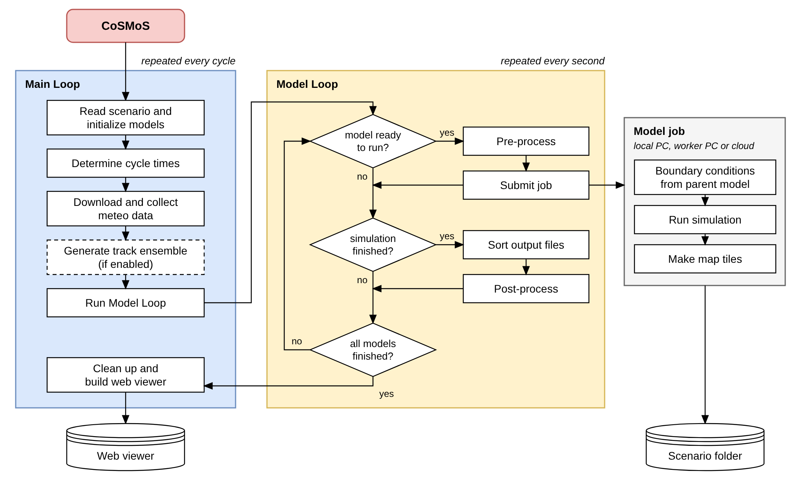

.. _workflow:

How CoSMoS works
----------------

This section describes what happens internally when CoSMoS runs a forecast
cycle.

Overview
^^^^^^^^

CoSMoS operates through two nested loops (Figure 1):

1. A **Main Loop** (blue) that runs once per forecast cycle — or once in hindcast
   mode.
2. A **Model Loop** (yellow) that iterates until all models have finished.

Each model simulation runs as a separate **job** (grey), started by the Model
Loop.

   Figure 1: Simplified CoSMoS workflow.

Initialization
^^^^^^^^^^^^^^

When you call :py:meth:`cosmos.initialize(main_path) <cosmos.cosmos.CoSMoS.initialize>`,
CoSMoS reads the :ref:`configuration file <configuration>` .
The configuration is stored in ``cosmos.config``
(:py:class:`~cosmos.configuration.Configuration`) and is accessible throughout
the system.

Main Loop
^^^^^^^^^

When :py:meth:`cosmos.run(scenario_name) <cosmos.cosmos.CoSMoS.run>` is called, CoSMoS first validates the
scenario (see :ref:`Running CoSMoS <running>`). The Main Loop (:py:class:`~cosmos.main_loop.MainLoop`) then performs the
following steps:

1. **Read scenario** — parse the :ref:`scenario TOML file <scenario>` and
   initialize all models.
2. **Determine cycle times** — set the cycle, the stop time, and the start time
   of each model (including spin-up or the restart file from a previous cycle).
3. **Run custom pre-processing** — run the user script set with
   ``pre_processing_script`` (optional).
4. **Download meteorological data** — fetch wind, pressure, and precipitation
   fields from configured data sources (see :ref:`Meteo <meteo>`).
5. **Collect meteorological data** — read the data into memory and, for
   tropical cyclones, find the storm track and write the spiderweb file.
6. **Generate track ensemble** — if ``run_ensemble = true`` in the scenario and
   a cyclone track was found, generate the track ensemble and add ensemble
   copies of all models that fall within the ensemble cone.
7. **Start Model Loop** — hand control to the Model Loop to execute all models. 
    Models that already finished in this cycle are skipped.
8. **Clean up** — once all models have finished, remove old files (if
   ``clean_up`` is enabled).
9. **Run custom post-processing** — run the user script set with
   ``post_processing_script`` (optional).
10. **Build web viewer** — generate the :ref:`web viewer <webviewer>` and
    upload it (if ``upload`` is enabled).

For tsunami events (``event_mode = "tsunami"``), steps 4 to 6 are replaced by
generating the initial tsunami wave.

Flow models with ``include_tide_only`` set in ``model.toml`` get a second,
tide-only run without meteorological forcing. CoSMoS uses the difference
between the two runs to make storm surge maps.

In continuous forecast mode, the Main Loop repeats at the configured cycle
interval (e.g. every 6 hours). Each cycle starts at the cycle time plus the
configured ``delay``. With ``catch_up`` enabled, CoSMoS skips cycles that were
missed and continues with the most recent one.

Model Loop
^^^^^^^^^^

The Model Loop (:py:class:`~cosmos.model_loop.ModelLoop`) repeats every second (every 20 seconds in cloud mode) and
manages the lifecycle of each model:

- **Check for finished simulations** — detect models whose job has completed
  and sort their files into the ``input``, ``output``, and ``restart`` folders.
- **Build waiting list** — determine which models are ready to run (i.e. their
  parent models have finished). In serial mode one model is started at a time;
  in parallel and cloud mode all models that are ready are started.
- **Pre-process** — for each model on the waiting list:

  - Copy the model input from the model database to the job folder
    (``scenarios/<scenario>/<cycle>/models/<model>``).
  - Set simulation times and output intervals.
  - Add observation points for stations and for nested models (nesting
    step 1).
  - Write meteorological forcing files.
  - Copy the job script for this model type to the job folder.

- **Submit** — start the job (locally, on a parallel worker, or in the cloud).
  The job itself extracts the boundary conditions from the parent model
  (nesting step 2), runs the simulation, and generates the map tiles.
- **Post-process** — for finished models, extract time series at the
  observation stations.
- **Check completion** — when all models have finished, return to the Main
  Loop.

Model nesting
^^^^^^^^^^^^^

CoSMoS uses a two-step nesting procedure:

- **Nesting step 1** (pre-processing of the parent model): observation points
  are added to the parent model at the boundary point locations of the child
  model, so that the parent writes output at those positions.
- **Nesting step 2** (start of the child model's job): time series are
  extracted from the parent model output and written as boundary conditions
  for the child model.

This is handled automatically based on the ``flow_nested`` and ``wave_nested``
keywords in the :ref:`model TOML files <models>`.

Execution modes
^^^^^^^^^^^^^^^

CoSMoS supports three execution modes, configured via ``run_mode`` in the
:ref:`configuration file <configuration>`:

- **serial** — all models run sequentially on the local machine.
- **parallel** — several models run at the same time. On Windows, models are
  distributed across multiple machines that share the same run folder; worker
  machines run ``run_parallel.py`` to pick up jobs. On Linux, jobs are started
  in the background on the machine that runs CoSMoS.
- **cloud** — models are submitted as Argo Workflow jobs on a Kubernetes cluster,
  with input/output transferred via AWS S3.
